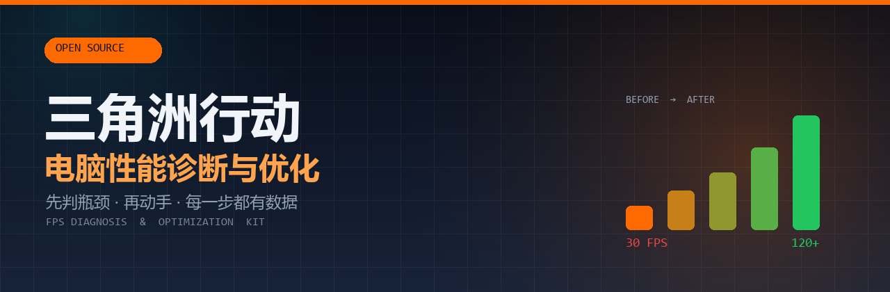
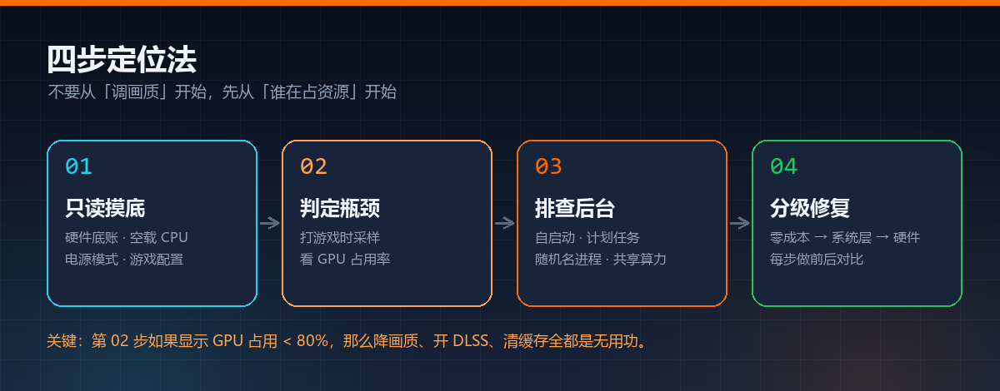
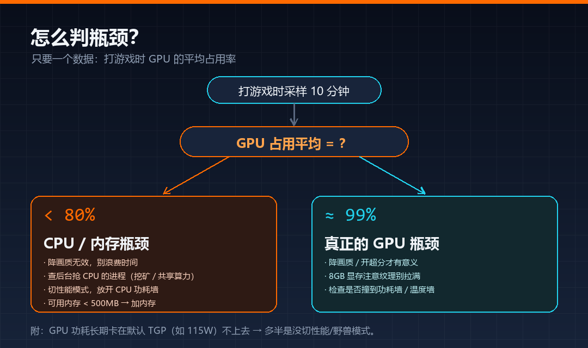
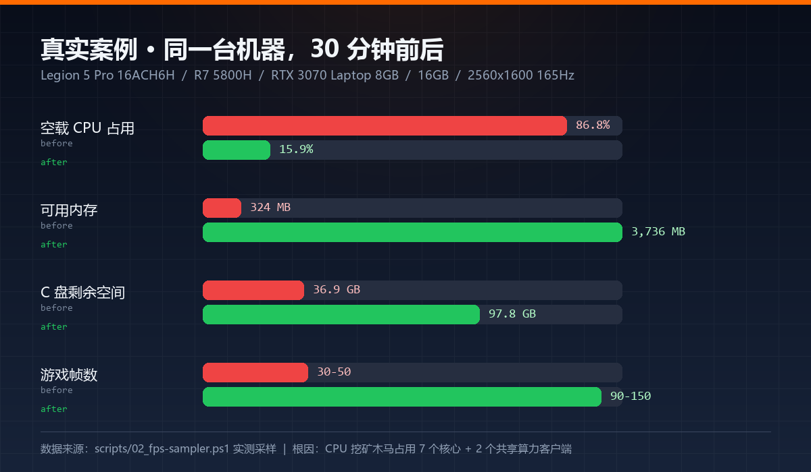

<div align="center">
  
</div>

<br>

<h1 align="center">Delta Force · PC Optimizer</h1>

<p align="center">
  <b>三角洲行动 · 电脑性能诊断与优化技能</b><br>
  <sub>先判瓶颈 · 再动手 · 每一步都有数据</sub>
</p>

<p align="center">
  
  
  
  
  
</p>

<p align="center">
  <a href="#-快速开始"><b>快速开始</b></a> ·
  <a href="#-四步定位法"><b>方法论</b></a> ·
  <a href="#-真实案例30-fps-的真相"><b>真实案例</b></a> ·
  <a href="#-常见误区"><b>避坑</b></a> ·
  <a href="#-作为-ai-技能使用"><b>AI 技能</b></a>
</p>

---

## ⚡ 三十秒看懂

<div align="center">
  
</div>

**低帧数时，90% 的人第一步就做错了** —— 他们开始调画质。

但真正该做的第一件事，是看一个数字：**打游戏时 GPU 的占用率**。

| 你以为是 | 大概率其实是 |
| :--- | :--- |
| 画质开太高 | **显卡根本没吃满** —— 降画质一帧都不会多 |
| 缓存坏了 | 缓存通常没问题，清了反而要重新编译，更卡 |
| 该"优化系统" | 后台有东西在偷跑（挖矿木马 / 共享算力软件 / 杀软互殴） |
| 内存不够 | 有可能，但先看空载 CPU 占用再说 |

> **一句话原则：GPU 没吃满（< 80%），瓶颈就在 CPU 或内存。**

---

## 🎯 这个仓库解决什么问题

针对 **《三角洲行动》**（以及绝大多数 Windows 游戏）的这两种症状：

- 🐢 **帧数低**：明明是最低画质，还是只有 30-50 帧
- 🌊 **卡顿**：帧数看着还行，但一顿一顿的、1% low 很惨

它提供：

| | 内容 |
| :--- | :--- |
| 🔍 **一套方法** | 四步定位法，每一步都用数据说话，不靠感觉 |
| 📊 **两个测量脚本** | 帧数采样、安全体检 —— 跑完就知道瓶颈在哪 |
| 🛠 **一份清单** | 从零成本到硬件升级，按性价比排序 |
| 🤖 **一个 AI 技能** | 把整套方法论交给 AI，让它帮你在这台机器上现场排查 |

---

## 🧭 四步定位法

### 01 · 只读摸底

先摸清底账，不碰任何设置：

- **硬件**：机型 / CPU / GPU（型号 + 显存 + 默认与最大功耗）/ 内存（几根、频率、是否双通道）/ 屏幕刷新率 / 硬盘型号
- **空载状态**（最关键）：不进游戏时，`系统 CPU 占用`、`可用内存`、`提交内存`、`页面文件位置`
- **系统设置**：电源计划、笔记本性能模式（如联想 `Fn+Q`）、GPU 功耗墙、HAGS、GameDVR、驱动版本
- **游戏配置**：分辨率、窗口模式、画质档位、超分档位与**实际内部渲染分辨率**、帧率上限

> ⚠️ 空载 CPU **> 30%** 就说明后台有东西在偷跑，继续往下查，别急着调游戏。

### 02 · 判定瓶颈

打一局游戏，用 [`scripts/02_fps-sampler.ps1`](scripts/02_fps-sampler.ps1) 采样 10 分钟。

<div align="center">
  
</div>

### 03 · 排查后台

如果 GPU 没吃满、或者空载 CPU 就很高，按这个顺序查：

| 位置 | 找什么 |
| :--- | :--- |
| 自启动 | `HKCU/HKLM \...\Run`、`RunOnce`、启动文件夹 |
| **计划任务** | 名字伪装成系统更新（如 `MicrosoftEdgeUpdateTaskUA Task-S-1-5-18 xxx`）但指向随机路径的 |
| 服务 | `ImagePath` 落在 `ProgramData`、`Users\Public`、`AppData`、`Downloads` 的 |
| 进程 | **随机名字**（纯小写 6-10 位）且路径可疑的 |
| 伪装程序 | 叫"XX安全组件"但**无签名**、版本信息残缺的 |
| **共享算力/带宽** | 拿你的 CPU/GPU/硬盘换钱的软件（会持续吃资源，打游戏时就是灾难） |

### 04 · 分级修复

<div align="center">

| 层级 | 做什么 | 成本 |
| :--- | :--- | :--- |
| **零成本** | 性能/野兽模式、插电源、关后台、独占全屏、帧率上限 = 刷新率 | 0 |
| **系统层** | 清临时文件、挪页面文件、去自启动、卸载重复软件 | 20 分钟 |
| **硬件层** | 内存 16→32GB、清灰换硅脂、换掉无 DRAM 的 QLC 硬盘 | 300-400 元 |

</div>

---

## 📊 真实案例：30 FPS 的真相

<div align="center">
  
</div>

**机器**：联想拯救者 Legion 5 Pro 16ACH6H · R7 5800H · RTX 3070 Laptop 8GB · 16GB · 2560×1600 165Hz

**症状**：最低画质 + 内部渲染只有 1484×928（58%），还是只有 30-50 帧。

**关键线索**：采样显示 **GPU 平均占用只有 36%**（最高 48%），CPU 却 **89%**。
→ 显卡有 2.5 倍余量，说明瓶颈根本不在画质。

**顺着 CPU 查下去，挖出**：

- 🦠 **CPU 挖矿木马**：`C:\ProgramData\xxxx\xxxx.exe`，随机名，占用 **696% CPU（7 个核心）**
- 🔒 **反向隧道后门**：伪装成 "Cloudflare Modernization Service"，指向陌生域名
- 📅 **9 个恶意计划任务**：伪装成 Edge / OneDrive 更新任务，重启即复活
- 🛡 **Windows Defender 被废**：注册表被写入 `DisableAntiSpyware=1`，服务 ACL 被改
- 💰 **2 个"共享赚钱"客户端**：一个共享 GPU 算力、一个共享 CPU/带宽/硬盘

**处置后**：空载 CPU `86.8% → 15.9%`，可用内存 `324MB → 3736MB`，帧数 `30-50 → 90-150`。

> 📖 完整过程见 [docs/case-study.md](docs/case-study.md)

---

## 🚀 快速开始

### 1️⃣ 先测一次（不改任何设置）

```powershell
# 下载仓库后，在 PowerShell 里运行
powershell -ExecutionPolicy Bypass -File .\scripts\02_fps-sampler.ps1 -Minutes 10
```

进游戏打 10 分钟，结束后把 `logs\perf_*.csv` 打开看：

- `gpu_util_pct` 平均 **< 80%** → 瓶颈在 **CPU / 内存**
- `gpu_util_pct` 平均 **≈ 99%** → 真的是 **GPU 瓶颈**，这时降画质才有用

### 2️⃣ 安全体检（强烈建议，每周一次）

```powershell
powershell -ExecutionPolicy Bypass -File .\scripts\03_security-audit.ps1
```

自动检查：Defender 状态、已注册杀软、自启动项、可疑计划任务、可疑服务、随机名进程、共享算力软件残留。
结果写到 `logs\audit_*.log`。

### 3️⃣ 清理系统垃圾（可预览）

```powershell
# 先看能清多少（不做任何改动）
powershell -ExecutionPolicy Bypass -File .\scripts\01_system-cleanup.ps1

# 确认后再真正清理
powershell -ExecutionPolicy Bypass -File .\scripts\01_system-cleanup.ps1 -Apply
```

### 脚本一览

| 脚本 | 作用 | 需要管理员 |
| :--- | :--- | :---: |
| [`02_fps-sampler.ps1`](scripts/02_fps-sampler.ps1) | 打游戏时采样 GPU/CPU/内存，判定瓶颈 | ❌ |
| [`03_security-audit.ps1`](scripts/03_security-audit.ps1) | 安全检查与后台排查 | ✅ |
| [`01_system-cleanup.ps1`](scripts/01_system-cleanup.ps1) | 清理临时文件 / 页面文件体检 | ✅ |

> 需要管理员的脚本会**自动弹 UAC**。双击无效的话，用上面命令行方式运行。
> 所有脚本默认把日志写到 `logs\`，把备份写到 `backup\`。

---

## ⚠️ 常见误区

<div align="center">

| ❌ 别做 | 为什么 |
| :--- | :--- |
| GPU 没吃满就降画质 | 瓶颈在 CPU，降画质收益为 0，只会让画面更丑 |
| 清理着色器 / PSO 缓存 | 缓存坏了才会卡；正常缓存清了要重新编译，前期更卡 |
| 清"待机内存"（ISLC 类） | 提交内存是真实需求，清完立刻填回，反而更慢 |
| 关 HPET / 关 MPO / 改 Timer Resolution | 现代 Windows 上收益接近 0，关 HPET 还可能出计时问题 |
| 装多个杀毒软件 | 互相扫描、互相拦，CPU 和磁盘一起遭殃 |
| 用"一键优化"脚本 | 来源不明、不可回滚，经常把正常功能关掉 |
| 一边挂"共享算力赚钱"一边打游戏 | 你的显卡/CPU 正在给别人打工 |

</div>

---

## 🔒 安全红线

<div align="center">

| 🚫 绝对不要 | 后果 |
| :--- | :--- |
| 向游戏注入 DLL / 替换游戏 DLL / 挂钩 DXGI | **反作弊判定作弊，可能永久封号** |
| 用"解锁帧数""画质增强"类 MOD | 同上 |
| 直接删系统文件 | 先移到隔离目录，观察几天再删 |

</div>

本仓库所有工具都**在游戏外面运行**，不注入、不修改游戏文件。

---

## 🤖 作为 AI 技能使用

把 [`SKILL.md`](SKILL.md) 或 [`docs/prompt.md`](docs/prompt.md) 交给任意 AI 助手（Claude / ChatGPT / DeepSeek / 通义 等），它就会按同一套方法论帮你排查。

**它不会**上来就让你"调画质、清缓存、关服务"，而是先要求数据：

```
AI：请先运行 02_fps-sampler.ps1 采样 10 分钟，把 CSV 给我。
你：（跑完发过去）
AI：GPU 平均占用 36%，CPU 89% → 瓶颈在 CPU。接下来查后台…
```

更进一步的用法：让 AI **直接生成带自动提权的 PowerShell 脚本**，你点一下 UAC 它就执行，每步都留备份和日志。

> 💡 详细用法见 [docs/methodology.md](docs/methodology.md)（含"如何让 AI 生成可回滚脚本"的模板）

---

## 📁 目录结构

```
delta-force-pc-optimizer/
├── assets/                  # README 配图
├── scripts/
│   ├── 01_system-cleanup.ps1
│   ├── 02_fps-sampler.ps1
│   ├── 03_security-audit.ps1
│   └── run-sampler.bat
├── docs/
│   ├── prompt.md            # 给 AI 的提示词（可直接复制）
│   ├── methodology.md       # 方法论 + 落坑记录 + 脚本模板
│   └── case-study.md        # 真实案例：30 FPS 的真相
├── SKILL.md                 # AI 技能定义
├── LICENSE
└── README.md
```

---

## 🙏 致谢

- 方法论来自一次真实的排查：3 小时从"以为是画质问题"到定位 CPU 挖矿木马
- 感谢所有愿意先看数据再下结论的人

## 📄 License

[MIT](LICENSE) © contributors

<br>

<div align="center">
<sub>如果这个仓库帮到了你，点个 ⭐ Star 让更多人少走弯路</sub>
</div>
